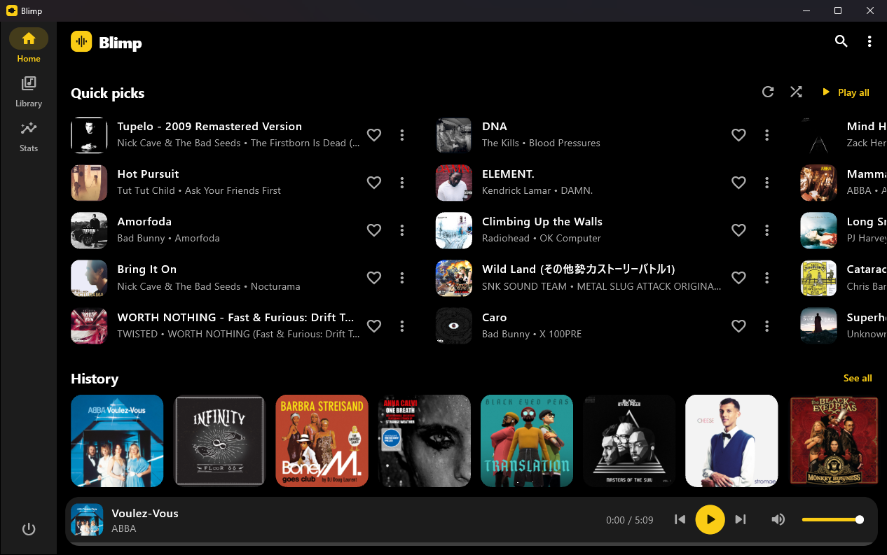
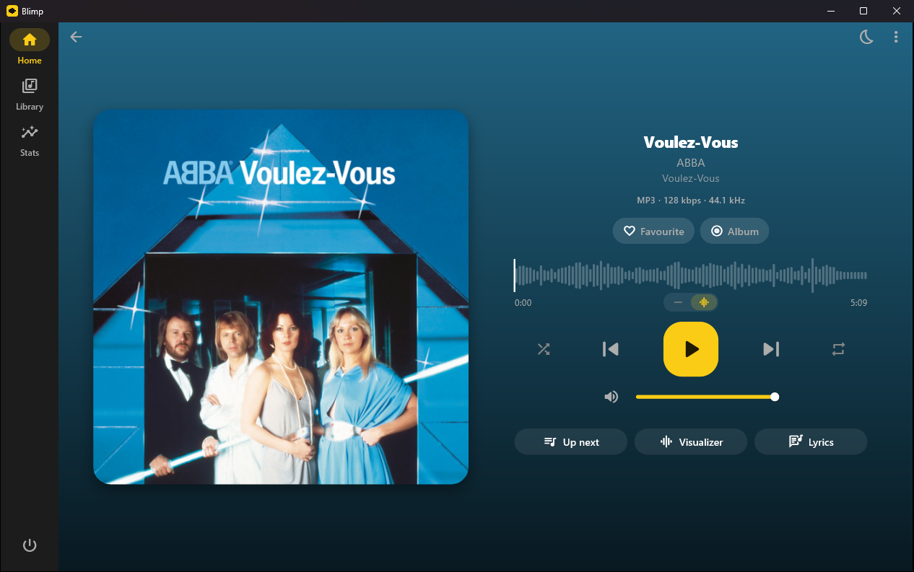
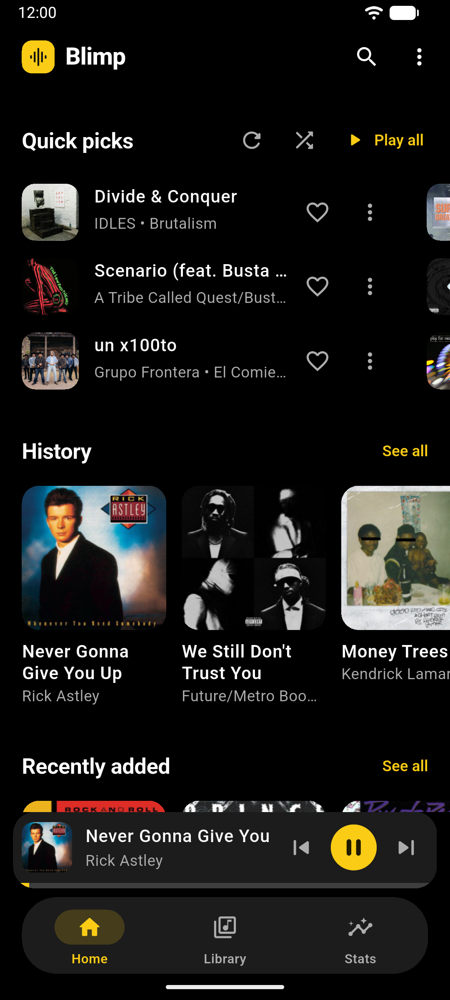
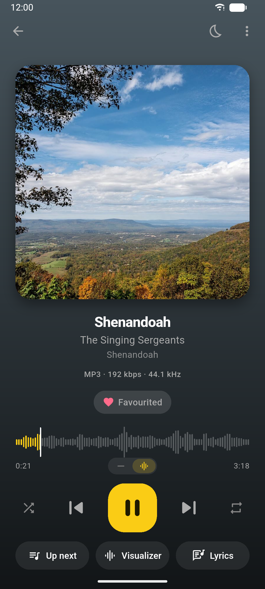
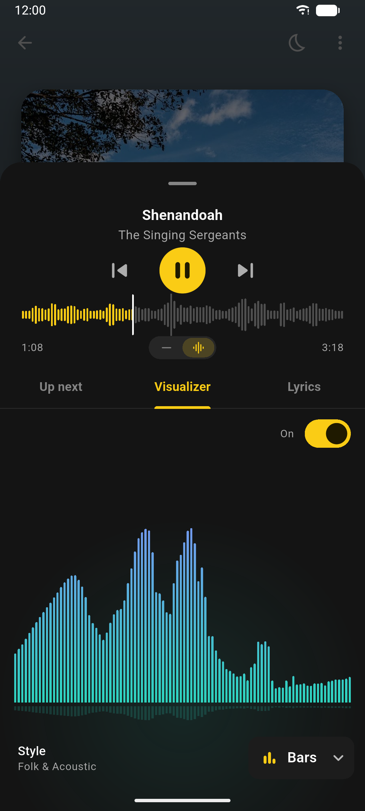
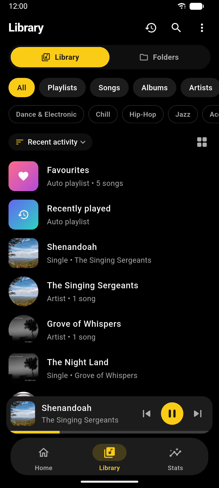
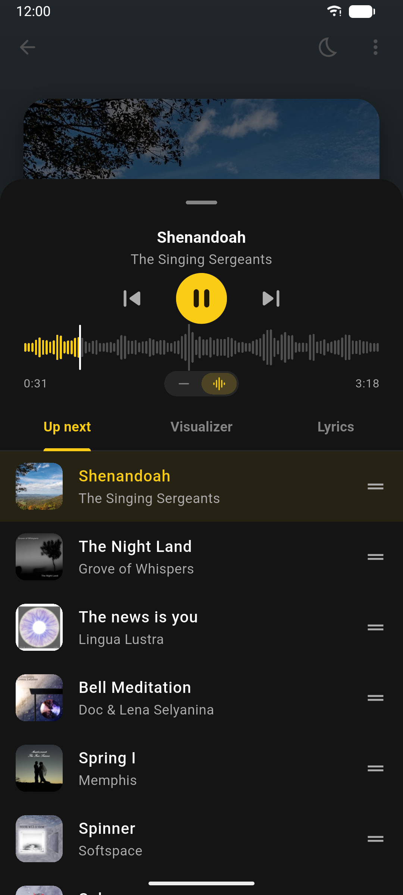

# Blimp

Blimp (Better Localized Music Player) is an offline music player for Android and Windows. 
Blimp plays the music already on your device: no accounts, no ads, no internet.

## Screenshots

### Windows

  
  

### Android

  
  
  
  
  

## Download

- **Windows 10 and 11:** get `Blimp-Setup.exe` from the
  [latest release](../../releases/latest).
- **Android:** coming soon to Google Play.

Windows may warn that the installer is from an unknown publisher. Click
**More info**, then **Run anyway**.

## Features

- **Live visualizer:** Bars, Mirror, Wave, Radial and Pulse styles.
- **Synced lyrics:** read from your files' tags or from `.lrc` files beside them.
  Tap a line to jump to it.
- **Sound:** hi-res badges, volume normalisation, crossfade,
  an equalizer, skip silence, and playback speed.
- **Library:** browse by songs, albums, artists, playlists, genres or folders.
  Albums are sorted into Albums, EPs, Singles and Compilations. Search ignores
  accents. Playlists import and export as M3U.
- **Listening stats:** top songs, artists and genres, and listening time.
- **Backups:** save your playlists, favourites, history, stats and settings to
  one file, and restore them on another device.
- **Private:** Blimp never goes online and collects nothing.

### On Windows

- Scans a music folder (Music by default; you can change it in Settings).
- Media keys and Windows' media flyout.
- Keeps playing in the system tray when you close the window.
- Pauses when headphones are unplugged.
- Keyboard shortcuts: Space plays and pauses, Ctrl+Left and Ctrl+Right skip,
  Ctrl+F searches.

### On Android

- Android Auto, home screen widgets, lock screen controls, and a sleep timer.

## License

Copyright © 2026 Mustaqim. All rights reserved.

You're welcome to read the source code here. You may not copy, modify or
redistribute it without permission. The bundled package in
`packages/just_audio_background` keeps its own license.
