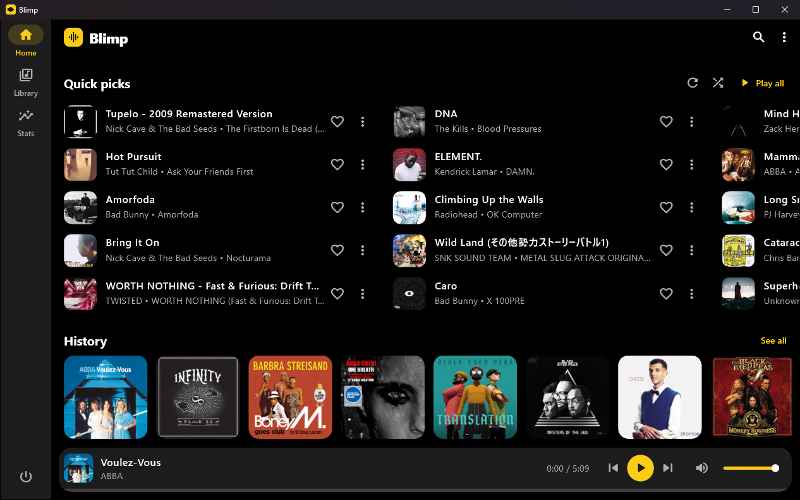
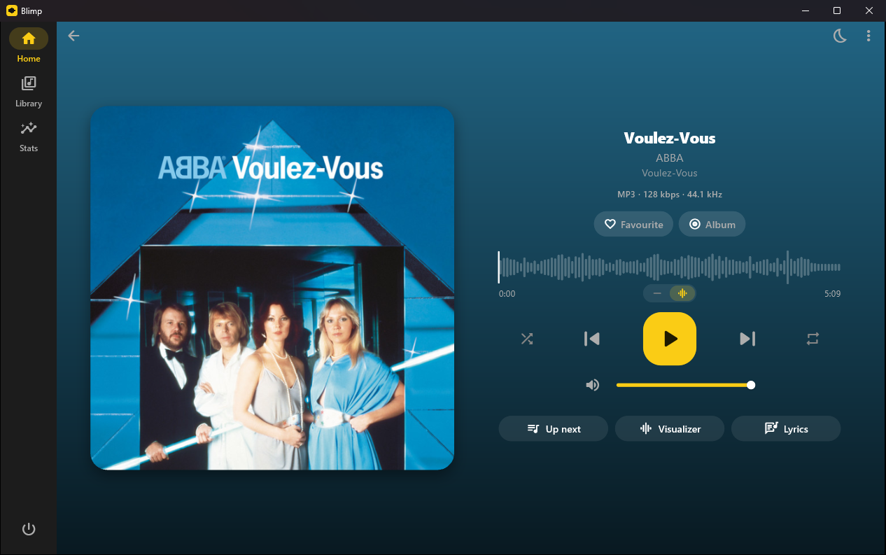
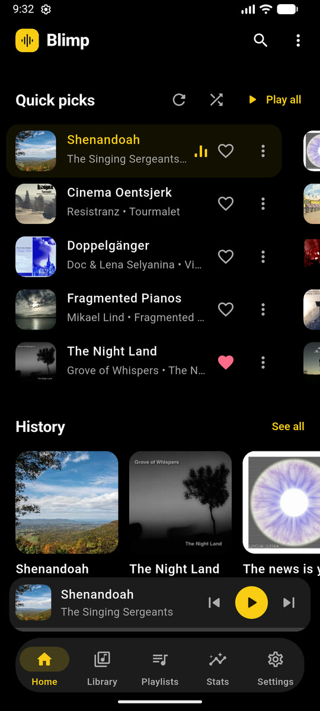
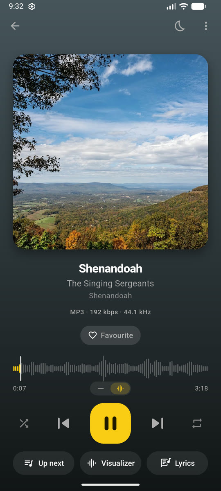
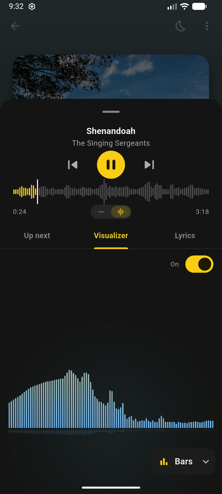
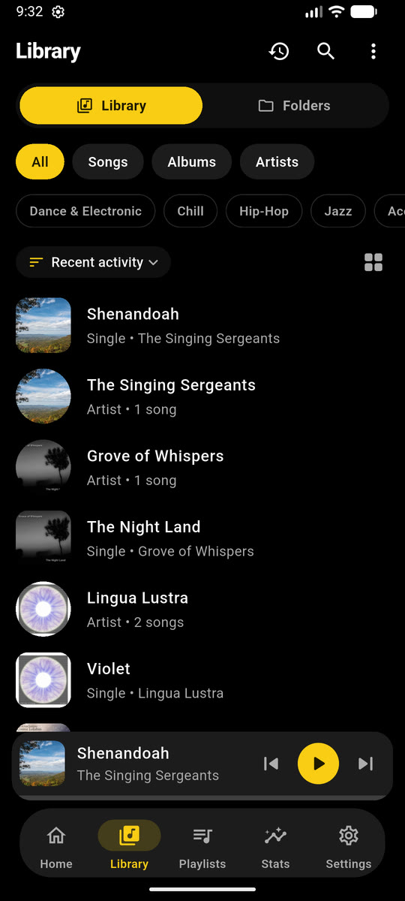
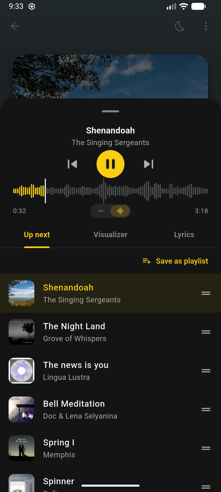

# Blimp

Blimp (Better Localized Music Player) is an offline music player for Android and Windows. 
Blimp plays the music already on your device: no accounts, no ads, and it works offline.

## Screenshots

### Windows

  
  

### Android

  
  
  
  
  

## Download

- **Windows 10 and 11:** get `Blimp-Setup.exe` from the
  [latest release](../../releases/latest).
- **Android:** get `Blimp.apk` from the [latest release](../../releases/latest).
  Coming to Google Play too.

Windows may warn that the installer is from an unknown publisher. Click
**More info**, then **Run anyway**. On Android, allow your browser or file
manager to install unknown apps if it asks.

## Features

- **Live visualizer:** Bars, Mirror, Wave, Radial and Pulse styles,
  coloured by the song's artwork.
- **Synced lyrics:** read from your files' tags or from `.lrc` files beside them.
  Tap a line to jump to it, or open Karaoke mode to sing along, word by word
  when the lyrics are timed that finely.
- **Search your lyrics:** search finds songs by the words in them, and plays
  from the line they're sung on.
- **Lyrics search:** when you ask, looks up a song, or your whole library, on
  [LRCLIB](https://lrclib.net), picking synced lyrics first, then plain ones.
  It only sends a song's title, artist, album and length, and keeps what it finds
  inside Blimp. On Windows you can choose to save lyrics into your music files.
- **Sound:** gapless playback, hi-res badges, volume normalisation, an
  equalizer, skip silence, and playback speed.
- **Fading between songs:** goes by the music, not just the clock. It skips
  silence at the ends of songs, and leaves alone a song that fades out by itself.
- **Quick picks:** songs you tend to play at this time of day, mixed with some
  at random.
- **Library:** browse by songs, albums, artists, playlists, genres or folders.
  Albums are sorted into Albums, EPs, Singles and Compilations. Search ignores
  accents. Playlists import and export as M3U.
- **Playlists:** your own, smart playlists that fill themselves by rules
  (genre, plays, rating, when last played and more), and the queue saved as
  a playlist.
- **Tidy up:** edit songs' tags and lyrics (MP3, FLAC, Ogg, Opus and M4A), rate
  songs with stars, and find duplicate songs to remove the extra copies.
- **Check lossless files:** finds FLACs and other lossless files that sound like
  they were made from an MP3, and hi-res files that are really CD quality.
- **Listening stats:** top songs, artists and genres, and listening time.
- **Top songs of the year:** a ranked playlist of your most played songs for
  each year you've listened, on the Playlists tab.
- **Streaks and badges:** days in a row with music, and badges to earn.
- **Time machine:** what you were playing this week a year (or a few months)
  ago, on Home.
- **Decade radio:** shuffle your songs from the '80s, '90s or any decade.
- **Six degrees:** see how two artists link through songs they share.
- **Song DNA:** a card of everything about one song: plays, skips, when you
  play it, its all-time rank and how it sounds.
- **Backups:** save your playlists, favourites, history, stats and settings to
  one file, and restore them on another device.
- **Private:** Blimp collects nothing, and only goes online if you search for
  lyrics or, on Windows, for missing tags, or for Discord covers if you turn on
  the Discord status.

### On Windows

- Scans a music folder (Music by default; you can change it in Settings).
- Open songs with Blimp from Explorer, or drag them onto its window.
- A compact player that stays on top of other windows.
- Media keys, Windows' media flyout, and play buttons on the taskbar preview.
- Keeps playing in the system tray when you close the window.
- Pauses when headphones are unplugged.
- Keyboard shortcuts: Space plays and pauses, Ctrl+Left and Ctrl+Right skip,
  Ctrl+F searches.
- Find missing tags, in Settings: lists songs missing tags or covers and fills
  them in with one click from iTunes Search and MusicBrainz,
  leaving tags you already have.
- Show what you're playing on your Discord profile, with covers found on iTunes
  Search, MusicBrainz and the Cover Art Archive and a link to the song on
  YouTube Music, through the Discord app on your PC. Off until you turn it on in
  Settings > Privacy & data.

### On Android

- Android Auto, home screen widgets, lock screen controls, and a sleep timer.
- Open songs with Blimp from a file manager or another app.
